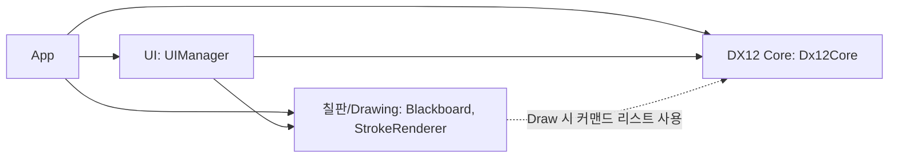
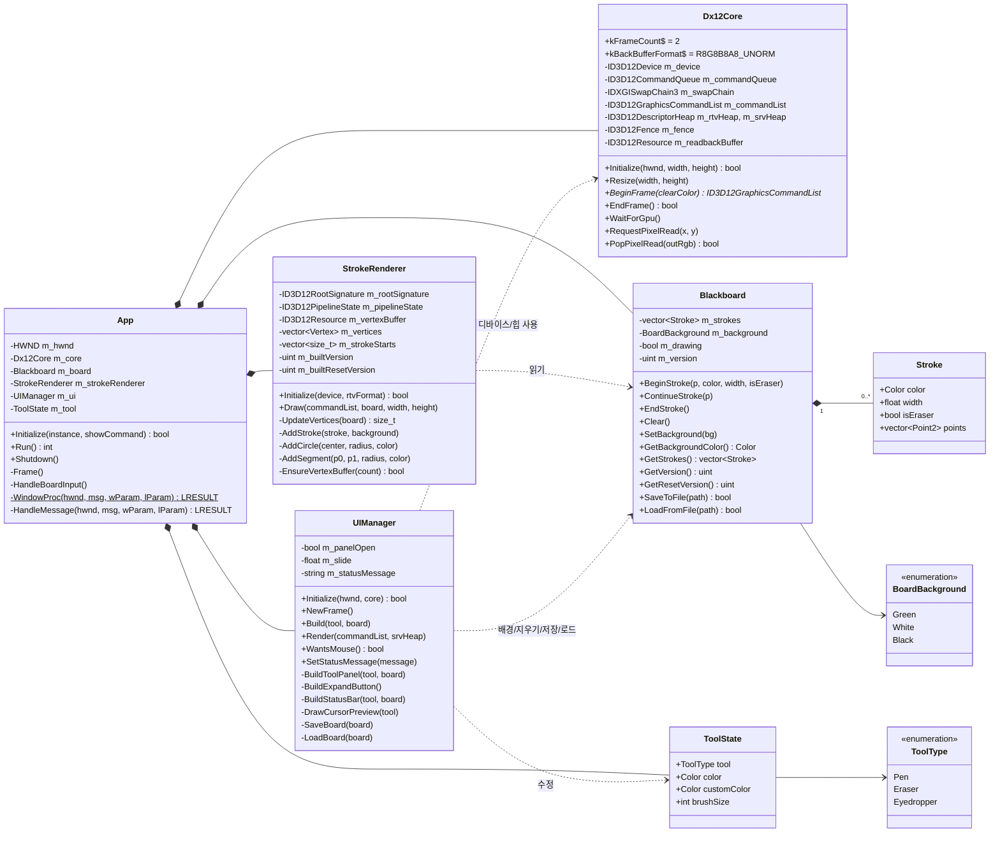
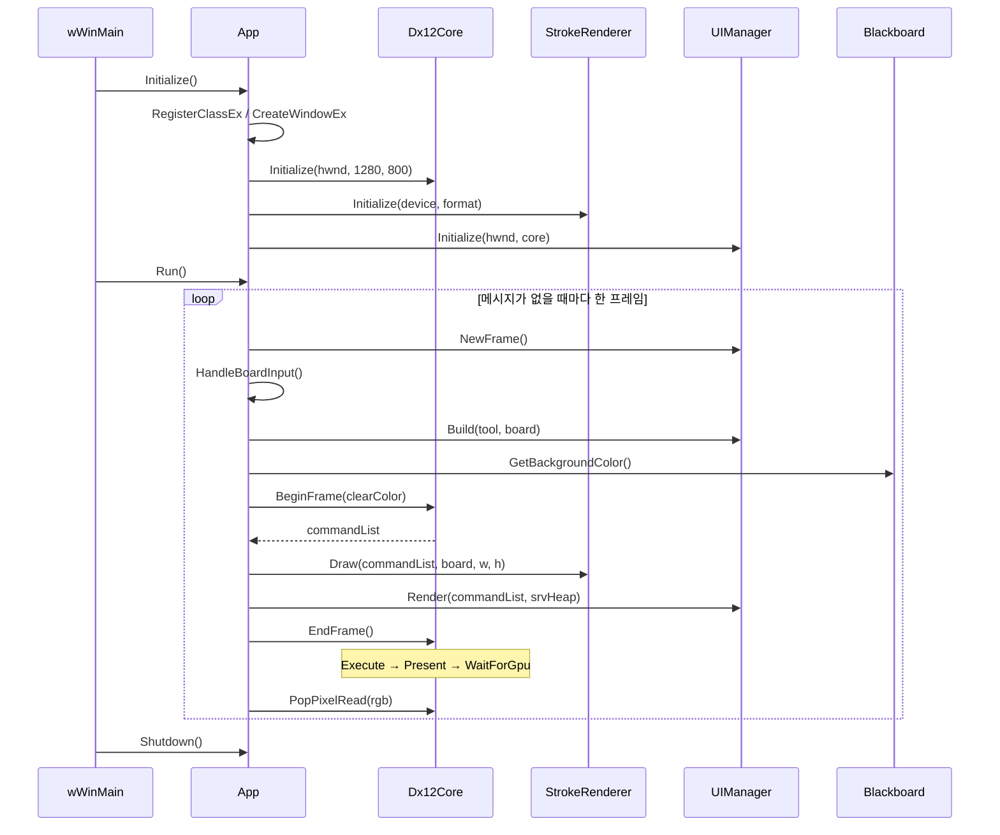
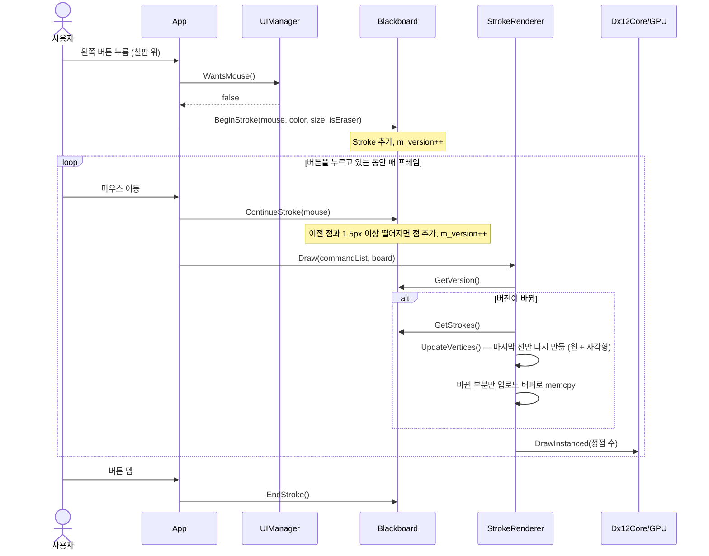
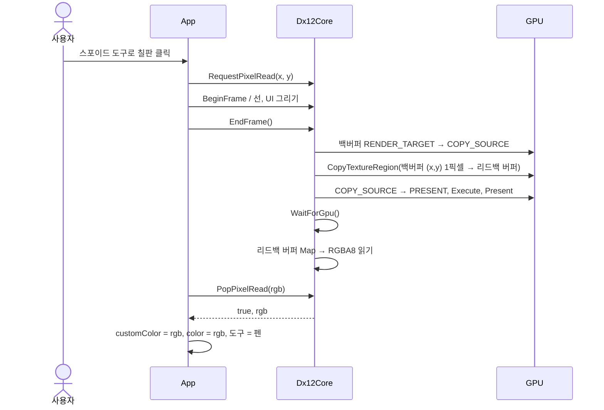
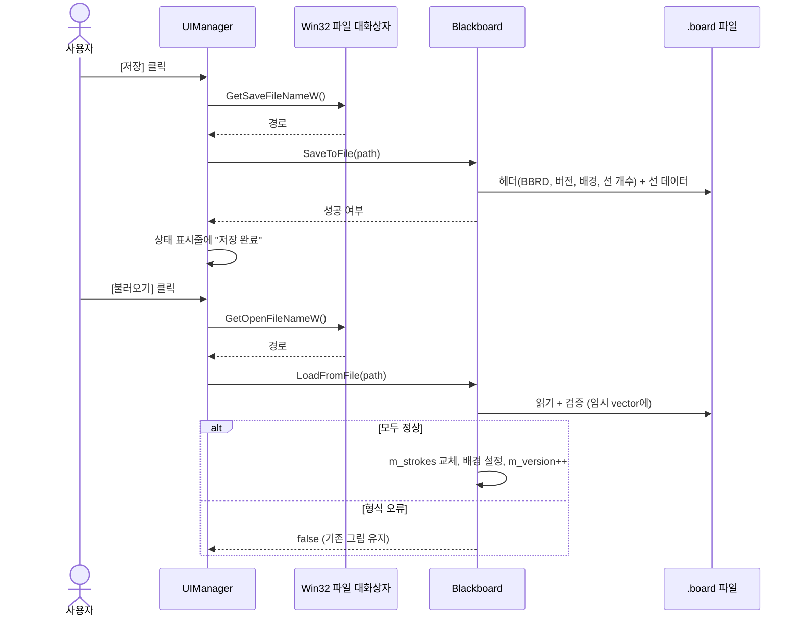
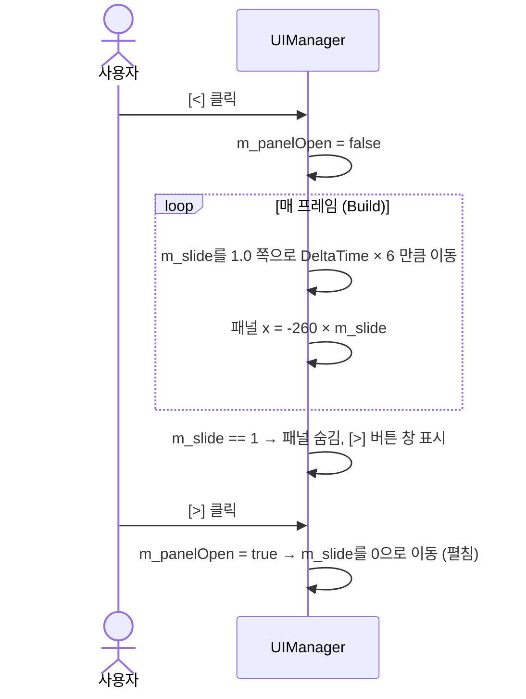

# DirectX 12 칠판 프로그램 구현 보고서

## 1. 개요

| 항목 | 내용 |
|---|---|
| 프로그램 | 마우스로 그림을 그리는 2D 칠판 |
| 그래픽 API | DirectX 12 (Win32 창) |
| UI | Dear ImGui v1.91.9b (Win32 + DX12 백엔드) |
| 언어 / 빌드 | C++17, Visual Studio 2022 (v143), x64 |

### 구현한 기능

| 요구사항 | 구현 내용 |
|---|---|
| 마우스 드래그로 선 그리기 | 드래그하는 동안 마우스 위치를 점으로 모으고, 점과 점 사이를 굵기만큼의 사각형 + 원으로 그림 |
| 그림 저장 / 로드 | 선 데이터(색, 굵기, 지우개 여부, 점 목록)와 배경색을 `.board` 바이너리 파일로 저장·로드 |
| 기본 색상 팔레트 | 검정·흰색·빨강·주황·노랑·파랑·남색·보라 8종 버튼 (검토 때 10종에서 8종 + 사용자 색상으로 변경) |
| 사용자 색상 (추가) | 색 박스 안의 포인트(채도/명도)와 색상 막대를 드래그해 RGB를 정함. R/G/B 값 표시·직접 입력도 가능 |
| 스포이드 (추가) | 프로그램 화면(백버퍼)의 픽셀을 GPU에서 읽어 RGB를 얻고, 사용자 색상으로 설정 |
| 붓 굵기 | 칠판 위에서 마우스 휠로 1~50px 조절, 패널 슬라이더와 연동 |
| 지우개 | 현재 배경색으로 그려지는 선 |
| 배경색 선택 | 초록 / 흰색 / 검정 |
| 패널 접기 (추가) | `<` 버튼으로 왼쪽 도구 패널이 미끄러지며 접히고, `>` 버튼으로 다시 펼쳐짐 |

## 2. UI 배치

UI 배치는 코드를 쓰기 전에 시안 두 개를 만들어 검토를 받았습니다. 왼쪽 고정 패널(A안)을 골랐고, 검토 의견에 따라 패널 접기, 사용자 색상, 스포이드를 추가하고 UI를 한글로 정했습니다.

```
┌──────────────────────────────────────────────────────────────┐
│┌──────────────┐                                              │
││ 도구       < │                                              │
││ 파일         │                                              │
││ [저장][불러오기]                                              │
││ [  전체 지우기  ]                                              │
││ 도구         │                  칠판 영역                     │
││ [펜][지우개][스포이드]           (창 전체, 패널 뒤까지)          │
││ 기본 색상    │                                              │
││ ■■■■■■■■     │                     ○ ← 붓 굵기 미리보기          │
││ 사용자 색상  │                                              │
││ ┌────────┐┃  │                                              │
││ │   ○    │┃  │                                              │
││ └────────┘┃  │                                              │
││ R  G  B      │                                              │
││ 붓 굵기 ━━●━ │                                              │
││ 배경 ◉초록 ○흰색 ○검정                                         │
│└──────────────┘                                              │
│ 도구: 펜  굵기: 8px  색: (255,255,255)  배경: 초록  선 개수 ...  │
└──────────────────────────────────────────────────────────────┘
```

- 칠판은 창 전체를 덮습니다. 패널은 그 위에 떠 있는 ImGui 창입니다. 그래서 패널을 접으면 가려져 있던 칠판이 그대로 드러나고, 선 좌표(창 픽셀 좌표)는 패널 상태와 상관없이 같습니다.
- 마우스가 ImGui 창 위에 있으면(`io.WantCaptureMouse`) 칠판은 입력을 받지 않습니다.

## 3. 아키텍처

요구사항대로 크게 세 부분으로 나누고, `App`이 이 셋을 연결합니다. 상속이나 인터페이스 없이 구체 클래스만 썼습니다.

| 구분 | 클래스 | 역할 |
|---|---|---|
| DirectX 12 Core | `Dx12Core` | 디바이스, 커맨드 큐/리스트, 스왑체인, RTV/SRV 힙, 펜스 동기화, 픽셀 리드백(스포이드) |
| 칠판과 Drawing | `Blackboard` | 선(Stroke) 목록과 배경색 보관, 그리기 시작/계속/끝, 파일 저장·로드 |
| | `StrokeRenderer` | 선 데이터를 삼각형 정점으로 바꾸고 셰이더/PSO로 그리기 |
| UI | `UIManager` | ImGui 초기화·렌더링, 도구 패널, 상태 표시줄, 커서 미리보기, 파일 대화상자 |
| (연결) | `App` | Win32 창과 메시지 루프, 칠판 마우스 입력 처리, 프레임 순서 관리 |

모듈 사이의 의존은 한 방향입니다.



## 4. 클래스 다이어그램



## 5. 시퀀스 다이어그램

### 5.1 프로그램 시작과 프레임 루프



### 5.2 마우스로 선 그리기



### 5.3 스포이드



### 5.4 저장 / 불러오기



### 5.5 도구 패널 접기 / 펼치기



## 6. 사용한 기법

### 6.1 DirectX 12 Core

- **기본 초기화 순서**: DXGI 팩토리 → 디바이스(기능 수준 11_0) → 커맨드 큐/할당자/리스트 → 스왑체인(`FLIP_DISCARD`, 백버퍼 2개) → RTV 힙 → 펜스. Debug 빌드에서는 D3D12 디버그 레이어를 켭니다.
- **리소스 상태 전환(Resource Barrier)**: 백버퍼를 `PRESENT → RENDER_TARGET → PRESENT`로 바꿉니다. 스포이드를 쓰는 프레임에는 그 사이에 `COPY_SOURCE` 상태를 넣습니다. `d3dx12.h` 헬퍼 없이 구조체를 직접 채워서 각 필드의 의미를 볼 수 있게 했습니다.
- **CPU-GPU 동기화**: 펜스 값을 올려 `Signal` 하고, `SetEventOnCompletion` + `WaitForSingleObject`로 기다립니다. 매 프레임 GPU가 끝날 때까지 기다리는 **가장 단순한 방식**입니다. 그래서 커맨드 할당자와 업로드 버퍼를 하나씩만 써도 안전합니다. 성능은 조금 손해를 보지만, 2D 칠판에서는 문제가 되지 않습니다.
- **창 크기 변경**: `WM_SIZE`에서 GPU 완료를 기다린 뒤 백버퍼를 해제하고 `ResizeBuffers` → RTV를 다시 만듭니다.

### 6.2 선 그리기 (칠판과 Drawing)

- **데이터 모델**: 그림을 픽셀이 아니라 **선(Stroke) 목록**(색, 굵기, 지우개 여부, 점 배열)으로 저장합니다. 그래서 저장 파일이 작고, 배경색을 바꾸거나 창 크기가 바뀌어도 언제든 다시 그릴 수 있습니다.
- **점 간격 줄이기**: 이전 점과 1.5px보다 가까운 점은 버려서 데이터 양을 줄입니다.
- **선 → 삼각형 변환(테셀레이션)**: GPU는 굵은 선을 직접 그리지 못하므로 CPU에서 삼각형으로 만듭니다.
  - 선분: 진행 방향에 수직인 법선 벡터 `(-dy, dx)/길이 × 반지름`으로 양쪽을 벌려 사각형(삼각형 2개)을 만듭니다.
  - 각 점: 반지름만큼의 원(8~32조각)을 그려 꺾이는 부분과 선의 끝을 둥글게 만듭니다(round join / round cap).
- **셰이더**: HLSL 소스를 문자열로 넣고 실행할 때 `D3DCompile`로 컴파일합니다. 정점은 픽셀 좌표로 넘기고, 정점 셰이더가 **루트 상수(32비트 상수 4개 = 화면 너비·높이 + 패딩 2개)**로 나눠 NDC로 바꿉니다. 상수 버퍼나 디스크립터 테이블이 필요 없는 가장 작은 루트 시그니처입니다. HLSL의 `cbuffer`는 16바이트(상수 4개) 단위로 크기가 잡히므로, 실제로 쓰는 값은 2개여도 루트 상수는 4개로 선언해야 셰이더와 크기가 맞습니다(QA 중 검증 레이어로 발견해 수정).
- **정점 버퍼**: 업로드 힙 버퍼를 한 번 `Map`해 두고 계속 씁니다. 공간이 모자라면 2배 크기로 다시 만듭니다.
- **버전 기반 캐싱 + 부분 갱신**: `Blackboard`는 데이터가 바뀔 때마다 `m_version`을, 전체 지우기·불러오기·배경 변경처럼 처음부터 다시 그려야 할 때는 `m_resetVersion`도 올립니다. `StrokeRenderer`는 버전이 바뀐 프레임에만 정점을 갱신하는데, `m_resetVersion`이 그대로면 그리는 중인 **마지막 선만** 다시 만들고 바뀐 부분만 GPU 버퍼로 복사합니다. (점 10만 개가 있는 칠판에서 그리는 중 프레임당 갱신 비용: 약 171ms → 0.04ms)
- **지우개**: 지우개도 선이며, `isEraser`인 선은 그릴 때 **현재 배경색**을 씁니다. 그래서 배경색을 바꾸면 지운 자국도 새 배경색을 따라가 항상 자연스럽게 지워진 것처럼 보입니다. 그리는 순서대로 덮어쓰므로 지우개 다음에 그린 선은 다시 보입니다.
- **파일 형식(.board)**: 매직 넘버 `BBRD` + 버전 + 배경 + 선 개수 + 선 데이터로 된 단순한 바이너리입니다. 불러올 때는 선/점 개수를 실제 남은 파일 크기와 비교하고(손상된 개수로 큰 메모리를 잡지 않도록), 색·굵기·좌표가 유한한 정상 범위인지 검사합니다. 임시 버퍼에 다 읽은 뒤에만 교체해서 잘못된 파일이 기존 그림을 망가뜨리지 않게 했습니다.

### 6.3 UI (ImGui)

- **즉시 모드 GUI**: 위젯 상태를 따로 객체로 두지 않고 매 프레임 `Begin/Button/Slider...`를 호출해 UI를 다시 그립니다. 버튼 함수의 반환값으로 클릭을 처리하므로 UI 코드가 위에서 아래로 그대로 읽힙니다.
- **고정 패널**: `SetNextWindowPos/Size` + `NoMove/NoResize/NoTitleBar`로 창 왼쪽에 고정합니다.
- **슬라이드 접기**: `m_slide`(0~1)를 `DeltaTime`에 비례해 목표값으로 옮기고, 패널 x 좌표를 `-260 × m_slide`로 둡니다. 다 접히면 패널 대신 `>` 버튼만 있는 작은 창을 보여 줍니다.
- **사용자 색상**: `ImGui::ColorPicker3`(`PickerHueBar`, `DisplayRGB`)를 씁니다. 사각형 박스 안의 포인트를 드래그하면 채도/명도가, 오른쪽 막대를 드래그하면 색상(Hue)이 바뀌고, 아래에 R/G/B 값이 표시되며 직접 입력도 할 수 있습니다.
- **입력 분리**: `io.WantCaptureMouse`가 true면 칠판 입력을 무시합니다. 단, 그리는 중에는 마우스가 패널 위로 지나가도 버튼을 뗄 때까지 선을 계속 이어 갑니다.
- **커서 미리보기**: `GetForegroundDrawList()`로 붓 굵기만큼의 원(흰색 + 검정 테두리)을 그립니다. 스포이드일 때는 가운데가 빈 링만 그려서 읽을 픽셀을 가리지 않게 했습니다.
- **한글**: Windows 기본 글꼴 맑은 고딕(`malgun.ttf`)을 한글 글리프 범위로 불러옵니다. 소스 코드는 UTF-8이고 `/utf-8` 컴파일 옵션을 씁니다. 글꼴 파일이 없으면 ImGui 기본 글꼴을 씁니다.

### 6.4 스포이드 (GPU 리드백)

화면에 실제로 보이는 색을 가져오려고 GPU의 백버퍼에서 직접 읽습니다.

1. 클릭하면 `RequestPixelRead(x, y)`로 요청만 기록합니다.
2. 그 프레임의 `EndFrame`에서 모든 그리기가 끝난 백버퍼를 `COPY_SOURCE`로 바꾸고, `CopyTextureRegion`으로 (x, y) 1픽셀을 **READBACK 힙** 버퍼에 복사합니다. 텍스처를 버퍼로 복사할 때는 행 피치를 256바이트(`D3D12_TEXTURE_DATA_PITCH_ALIGNMENT`)에 맞춰야 해서 버퍼 크기도 256바이트입니다.
3. GPU 완료를 기다린 뒤 `Map`해서 RGBA8 4바이트를 읽습니다.
4. 백버퍼 형식이 `R8G8B8A8_UNORM`(감마 변환 없음)이라서, 읽은 값이 화면에 보이는 RGB와 정확히 같습니다.

## 7. 프레임 처리 순서 요약

1. Win32 메시지 처리 (입력은 ImGui Win32 백엔드에 먼저 전달)
2. `UIManager::NewFrame()`
3. `App::HandleBoardInput()`: 선 시작/계속/끝, 휠로 굵기 조절(휠 양을 누적해 1칸 단위로 반영), 스포이드 요청
4. `UIManager::Build()`: 패널, 상태 표시줄, 커서 미리보기
5. `Dx12Core::BeginFrame()`: 배경색으로 지우기
6. `StrokeRenderer::Draw()`: 선
7. `UIManager::Render()`: ImGui
8. `Dx12Core::EndFrame()`: (스포이드 복사) → 실행 → Present(장치 제거 오류 검사) → GPU 대기
9. 스포이드 결과 반영

## 8. 한계와 개선할 수 있는 점

과제용 단일 프로젝트라서 아래 항목은 일부러 넣지 않았습니다.

- 매 프레임 GPU를 기다리는 동기화 → 프레임 리소스를 여러 개 두면 CPU와 GPU가 겹쳐서 일할 수 있습니다.
- 전체 지우기/불러오기/배경 변경 때는 정점 전체를 다시 만듭니다(점 10만 개 기준 약 0.17초). 더 줄이려면 렌더 타깃 텍스처에 누적해서 그리는 방식을 쓸 수 있습니다.
- 안티에일리어싱 없음 → MSAA나 셰이더에서 가장자리 알파 처리를 넣을 수 있습니다.
- 실행 취소(Undo), 고해상도(DPI) 대응 없음.
- 창 테두리를 끌어 크기를 바꾸는 동안에는 Windows가 메시지 루프를 잡고 있어 새 프레임이 그려지지 않습니다(놓으면 정상).

## 9. 빌드 확인

- Visual Studio 2022 프로젝트(`BlackboardProj.sln`, x64 Debug/Release)로 구성했습니다.
- 작성 환경(Linux)에서 MinGW-w64 크로스 컴파일러로 모든 소스를 컴파일·링크해 문법과 링크 오류가 없는 것을 확인했습니다.
- 단위 테스트(`Tests/UnitTests.cpp`, 35개)와 화면 조작 E2E 테스트(24개)를 Wine + vkd3d(소프트웨어 Vulkan)에서 실행해 확인했습니다. 자세한 결과는 [QA 보고서](QA_Report.md)에 있습니다.
- 실제 Windows + GPU 환경에서의 최종 확인은 Visual Studio에서 빌드해 진행해야 합니다.
